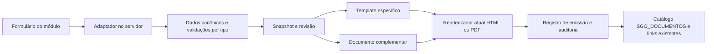

# SGO+ — diagnóstico e proposta de arquitetura documental

Fases 1 e 2 da solicitação de reestruturação global recebida em 08/10/2026. Escopo: código local de `apps-script-imports/portal_sgo_versao_cnpj_db`, projeto Apps Script do Portal SGO+. O arquivo ativo de RH não é o projeto auditado. Nenhuma mudança estrutural ou publicação foi executada nesta etapa. As correções anteriores de CertCal permanecem em desenvolvimento.

## Inventário inicial

O levantamento estático encontrou 47 arquivos com sinais de emissão, impressão, template, arquivo Drive ou snapshot. Isso NÃO significa 47 geradores: alguns são loaders, armazenamento de anexos ou páginas auxiliares. A lista rastreável está em `INVENTARIO_GERADORES_SGO_20261008.json`; o script `_tools/inventariar_geradores_sgo_20261008.cjs` decodifica os templates guardados em strings e informa função candidata, tecnologia e trecho. A leitura dos módulos distingue os caminhos abaixo.

| Família | Geradores e dependências existentes | Caminho e ponto de atenção |
|---|---|---|
| Calibração própria | SGO_CertCal_Main/Calculo/Documento/IA/Config; ConteudoModulo; JS_Core mobile | PDF por Blob.getAs(PDF), snapshot em Sheets e registro documental; certificado/interpretativo derivados do mesmo contexto. Reutilizar as correções já testadas |
| Interpretação de certificado externo | SGO_RelCal_Main/Documento/IA/Config | Extração/interpretação de PDF externo; salvarDocumento recebe HTML pronto. Não deve ser tratado como nova calibração executada pela Metrolabs |
| Autoclave | SGO_AutoRel_CertificadoRelatorio; AutoclaveCertificado.html; Main; MemoriaF0 | HtmlService/template e impressão browser; memória F0 separada. Existe assinatura SHA do contexto, distinta de assinatura profissional |
| Lavadora | SGO_LavRel_CertificadoRelatorio; LavadoraCertificado.html; Main | HtmlService/template e impressão; regras próprias de qualificação, não transportar automaticamente a política de certificado de calibração |
| Estufa/banho | SGO_EstufaBanhoRel_CertificadoRelatorio; EstufaBanhoCertificado.html; Main | HtmlService/template; hash do contexto e conferência dos textos. Necessário vínculo explícito entre prévia, revisão e emissão |
| Cadeia de frio | SGO_CadeiaFrioRel_CertificadoRelatorio; CadeiaFrioCertificado.html; Main/Config | Template e impressão; Config é também fonte de identidade/logo/assinaturas de outros módulos, criando acoplamento |
| NR13 | SGO_NR13_Main/Documento | PDF servidor, JSON/contexto e logs; regras e responsável técnico próprios |
| Gestão de padrões | SGO_Padroes_Documentos/DocumentoHTML/DocumentoCSS; JS_Padroes_Documentos; Automacao | HTML e JSON privados no Drive, histórico, requestId, revisão/hash e trava. Base útil para idempotência; não converter indiscriminadamente orçamento/controle em certificado |
| Declaração de execução | SGO_DeclaracaoExec_Documento/DocumentoQIQO e Main | Declarações/variantes QI-QO; conferir validação no servidor e HTML recebido do cliente |
| Cronograma | SGO_CronExec_Documento e Main | Documento operacional; não aplicar incerteza ou próxima calibração |
| Registros operacionais | SGO_RegOp_Documento/Main | Impressão e PDF servidor; dados e responsabilidades específicos |
| PGT/POP | SGO_PgtPop_Documento/Main/Config | PDFs, revisões e histórico existentes; aprovação documental difere de aprovação metrológica do equipamento |
| Planejamento CME | SGO_PlanCME_Documento/Main | HTML e PDF, cenário/plano operacional; preservar cálculos específicos |
| Assistência técnica/Auvo | SGO_Auvo_Relatorio/RelatorioIA/Main | Relatórios HTML dos dados de integração; investigar vínculo com OS externa e congelamento na emissão |
| Frota | SGO_Frota_Relatorio/Main | Relatórios operacionais/gerenciais, fora da política de calibração |
| Conduta/missões | SGO_Conduta_Relatorio/RelatoriosGerenciais/Main/Missao | Relatórios individuais e gerenciais; regras de período e reprocessamento devem ter revisão formal |
| Qualidade | SGO_Qualidade_Relatorio/Main | Relatório gerencial HTML; critérios específicos de indicadores |
| Inventário | SGO_Inventario_ConteudoModulo/Main | tplInv_buildPrintHtml_, tplInv_buildStandaloneHtmlParaPdf_, overlay/print; inventarioSalvarDocumento recebe HTML do navegador e converte para PDF |
| Gestão da calibração | SGO_CertCal_GestaoRelatorios/GestaoIA | Relatórios gerenciais, orçamento/prioridades/gráficos; não são certificados de medição |
| Equipamentos | JS_Equipamentos.html; SGO_QRCode/Equipamentos | Impressão de QR/ficha; manter identificadores e acesso aos documentos |
| Carta de conformidade legada | SGO_CartaConformidade; JS_CartaConformidade | Proxy UrlFetchApp para outro motor; comentário declara legado para consulta, mas wrappers de geração/salvamento permanecem. Não reativar emissão ao padronizar |
| Cadastro documental | SGO_Documentos.js; DOC_DOCUMENTOS | Upload/registro/listagem/atualização; não é motor de geração. É integração a preservar, não infraestrutura suficiente de revisão imutável |

Categorias contratos/aditivos, estoque/peças/compras e termos de entrada/entrega não devem ser inventadas a partir dos nomes das pastas. `SGO_Documentos` cria categorias como Contratos e Ordens de Serviço para armazenamento, o que não prova um gerador nativo. Integração OSPlus e motores externos precisam de inventário próprio quando seus fontes forem localizados. Este diagnóstico não declara que um motor externo está validado pela leitura do proxy.

## Rotas conferidas por leitura dos módulos

| Família | Funções reais de geração/emissão |
|---|---|
| AutoRel | AutoRel_apiGerarRascunhoCertificado → AutoRel_apiMontarCertificadoFinal; AutoRel_apiConverter; memória F0 complementar |
| LavRel | LavRel_apiGerarRascunhoCertificado → LavRel_apiMontarCertificadoFinal; LavRel_apiConverter |
| Estufa/banho | EstufaBanhoRel_apiGerarRascunhoCertificado → EstufaBanhoRel_apiMontarCertificadoFinal |
| Cadeia de frio | CadeiaFrioRel_apiGerarRascunhoCertificado → CadeiaFrioRel_apiMontarCertificadoFinal |
| CertCal | CertCal_apiGerarCertificado; CertCal_apiGerarRelatorioInterpretativo |
| RelCal | RelCal_apiGerarDocumento; RelCal_apiSalvarDocumento |
| NR13 | NR13_apiSalvarRascunho; NR13_apiEmitirLaudo; NR13Doc_montarDocumentoHtml_ |
| Padrões | CertCal_apiGerarDocumentoPadroes; CertCal_apiEmitirDocumentoPadroes; PadDoc_html_ |
| Declaração/QI-QO | DeclExec_apiGerarRascunho; DeclExec_apiGerarRascunhoQIQO; DeclExec_apiMontarDocumentoFinal; DeclExec_apiSalvarDocumento |
| Cronograma | CronExec_apiFinalizar; CronExec_salvarCronograma_; CronExec_montarDocumentoHtml_; CronExec_apiSalvarDocumento |
| Registro operacional | RegOp_apiGerarRegistro; RegOp_montarDocumentoHtml_; RegOp_registrarDocumento_ |
| PGT/POP | PgtPop_apiGerarDocumento; PgtPop_salvarPgt_; PgtPop_salvarPop_; PgtPop_salvarPdfAutomatico_; PgtPop_apiSalvarDocumento |
| Planejamento CME | PlanCME_calcularPlanejamento; PlanCME_salvarPlanejamento; PlanCME_apiMontarDocumentoFinal; PlanCME_apiSalvarDocumento |
| Auvo | Auvo_apiGerarRelatorio; Auvo_montarContextoRelatorio_; Auvo_montarRelatorioHtml_ |
| Frota | Frota_apiGerarRelatorio; FrotaRel_montarDocumentoHtml_; FrotaRel_montarDocumentoVeiculoHtml_ |
| Conduta | Conduta_apiFecharCompetencia; Conduta_apiGerarRelatorio; Conduta_apiGerarRelatorioSemanal; Conduta_apiGerarRelatorioMissoes; CondutaRG_salvar_ |
| Qualidade | Qualidade_apiGerarRelatorio; Qualidade_montarContextoRelatorio_; Qualidade_montarRelatorioHtml_ |
| Inventário | inventarioGerar; inventarioSalvarDocumento; SGO_INVENTARIO.gerarInventario/salvarDocumento |
| Catálogo | SGO_DOCUMENTOS.registrarDocumentoExistente; documentosRegistrarExistente; CRUD documental |

Outros caminhos externos encontrados: `SGO_TemplateAutoclave.js` e `SGO_TemplateLavadora.js`, com `tplAutoclaveGerarRelatorio`/`tplLavadoraGerarRelatorio` delegando a outros motores. Separar dos módulos AutoRel/LavRel internos e confirmar quais continuam acessíveis. Resumos de sincronização OS+ por e-mail são saídas operacionais de integração; não foram executados nem tratados como certificados.

## Problemas comuns comprovados

1. Há impressão browser, HtmlService/template, concatenação de HTML e conversão GAS Blob→PDF. A renderização headless dos exemplos locais não comprova identidade de paginação com getAs(PDF) no Google.
2. Há rotas que recebem HTML já montado pelo navegador. Por exemplo, Inventário valida presença do HTML e sessão, mas não reconstrói um documento de dados canônicos validados no servidor. Uma validação visual no cliente não protege o conteúdo emitido.
3. `SGO_DOCUMENTOS.atualizar` troca metadados/link no mesmo ID e `inativar/reativar/excluir` alteram o cadastro. Isso precisa ser separado da revisão formal de um documento emitido: arquivos históricos e sua identidade não devem ser reescritos.
4. `SGO_DATA.log` captura erros e os ignora. É útil para logs gerais, mas não basta para garantir a trilha obrigatória de uma emissão auditável.
5. Rastreabilidade não é uniforme: alguns módulos guardam snapshot/hash e outros apenas HTML ou resultado do estado atual. Inserir um nome de revisor no rodapé não comprova que uma revisão aconteceu.
6. A identidade institucional e as assinaturas usadas em CertCal vêm de CadeiaFrioRel_Config. A extração para uma camada comum deve preservar a configuração anterior e os responsáveis por categoria.
7. Inventário distingue SEM_VENCIMENTO de SEM_DOC, mas seus indicadores de «Calibração em dia» contam OK pelo vencimento. A nova próxima calibração do contratante deve ter semântica própria; ausência de validade não significa documento ausente nem aprovação técnica.
8. Existem arquivos compartilhados por link e arquivos privados. Padronizar emissão não autoriza mudar permissões Drive nem ampliar acesso a clientes.

## Riscos específicos que precisam entrar no plano de correção

- NR13: o renderizador usa o primeiro signatário configurado quando não encontra o nome solicitado. Não substituir um responsável desconhecido por outro automaticamente. A próxima inspeção NR13 segue política própria, distinta de próxima calibração.
- LavRel/CadeiaFrio: a montagem final não tem o mesmo vínculo por hash do rascunho presente em AutoRel/Estufa. Todos os quatro precisam congelar a emissão, inclusive texto revisado e configuração visual.
- RegOp: falha de PDF pode ser silenciada e ainda haver registro sem artefato. CronExec: finalizar não verifica `salvo.ok` antes do sucesso. A nova infraestrutura deve distinguir emissão concluída de preparação ou falha.
- PGT/POP: têm histórico e incremento de versão, mas concorrência na consulta/incremento pode colidir; aprovadores/rubricas de Config não comprovam atos de aprovação autenticados.
- Conduta: fechamento financeiro está congelado com lock, mas a narrativa HTML/contexto de um período pode ser sobrescrita. Cada nova narrativa deve ser edição documental independente, ligada ao mesmo fechamento.
- Carta legada: caminhos frontend de geração continuam mesmo após falha de auditoria; alguns wrappers de salvar/auditar/refinar não exigem sessão no próprio corpo. Verificar exposição real e impedir emissão nova do legado conforme política declarada, preservando a consulta.
- Alguns dispatchers autenticam, mas funções públicas chamadas diretamente podem não repetir a verificação. A autorização deve existir no limite público da operação, sem depender apenas da sequência visual do formulário.
- Setups CronExec/PlanCME/PGT contêm limpeza de tabelas. Não chamar esses setups como migração da arquitetura; usar migração aditiva e verificar os nomes reais das abas e os aliases resolvidos por SGO_DATA antes de criar índice central.
- Popups e impressão local podem falhar ou permitir salvar PDF sem registro oficial. Distinguir prévia/rascunho de emissão e oferecer artefato arquivado sem tratar `window.print()` como confirmação de emissão.

## Arquitetura proposta — compatível com os motores atuais

Adicionar `SGO_DocCore.js`, `SGO_DocRegras.js` e `SGO_DocTextos.js`, sem renomear ou substituir os geradores existentes. Esses nomes são proposta, ainda não arquivos implementados. SGO_DOCUMENTOS continua sendo o catálogo de arquivos.

### Contrato comum

Envelope com ID interno UUID e numeração visível preservada por módulo; tipo/categoria; schemaVersion, templateVersion, regrasVersion, textosVersion, motorVersion; revisão, documento anterior e justificativa; cliente/unidade/equipamento/serviço conforme aplicabilidade; data civil separada do timestamp de emissão; autor, revisor e emissor autenticados com registro dos atos; snapshotHash e arquivoHash; documentos relacionados e sourceSnapshotId. Valores brutos e unidade permanecem estruturados, nunca extraídos da string formatada. Graus de liberdade infinitos precisam de representação explícita serializável, não Infinity convertido silenciosamente em null no JSON.

O documento complementar utiliza o MESMO snapshot aprovado para emissão, sem consultar cadastros atualizados para trocar a identidade histórica nem refazer cálculos. Coerência é conferida nos campos canônicos antes do render e no vínculo dos documentos; comparação de texto HTML não substitui conferência de resultados. IA pode produzir texto de apoio, mas não números, critérios ou decisões novos.

### Validações específicas

Cada tipo declara campos obrigatórios, unidades, datas, resultados, relações, responsável técnico e regras de conclusão. Resultado da validação contém código, campo, severidade e mensagem. Erro crítico bloqueia renderização oficial/emissão; aviso fica registrado com decisão de revisão quando exigida. Não preencher lacunas com zero, «aprovado» ou nomes de revisores fictícios. Contrato, OS, gerencial, POP, qualificação e calibração têm regras distintas.

A política reutilizável de próxima calibração só é ativada em tipos que emitem resultados de calibração pertinentes. Para interpretações de certificados de terceiros, preservar a autoria da informação original; uma data do PDF externo não prova solicitação do cliente à Metrolabs. A categoria documental governa a funcionalidade; não usar apenas uma palavra do título para decidir.

### Textos versionados

Biblioteca identifica texto, versão, categoria, origem, situação de revisão e responsável real pela aprovação técnica. Os textos explícitos do novo pedido substituem os do pedido anterior nos NOVOS documentos quando a implementação for iniciada. Não declarar que todos os textos já foram aprovados tecnicamente. Textos de limitações contratuais e ensaios dependem de revisão dos respectivos responsáveis; não derivar um contrato de frases de calibração.

### Histórico e auditoria

Proposta de abas novas e aditivas, sem alterar colunas históricas: DOC_EMISSOES, DOC_REVISOES e DOC_EVENTOS. Snapshot pode ser guardado em JSON privado no Drive para não pressionar células com fotos/textos extensos. A emissão precisa de requestId idempotente, verificação de hash/revisão entre prévia e emissão e LockService na reserva numérica. Registrar solicitante da próxima calibração e usuário/hora autenticados no servidor.

Estados propostos: RASCUNHO → VALIDADO → REVISADO quando o tipo exigir → EMITIDO. Revisão cria novo registro e arquivos, com vínculo ao predecessor; cancelamento gera evento e não apaga o arquivo original. Não importar registros antigos com aprovação, solicitação ou revisão inventadas. Histórico não migrado continua LEGADO com os dados disponíveis.

Sheets e Drive não oferecem uma transação única para arquivo, numeração e registro. Implementar estado de preparação/erro, retentativa idempotente e reconciliação para evitar arquivo sem registro ou duplicação. Auditoria crítica deve retornar confirmação/erro verificável, em vez de depender exclusivamente do log genérico que suprime falhas.

## Riscos e mitigação

| Risco | Estratégia |
|---|---|
| Alterar numeração/link e quebrar QR/documentos anteriores | Preservar ID/numeração/link legado; novos IDs internos e vínculos aditivos |
| Misturar revisão de cadastro e revisão técnica | Manter catálogo, criar histórico separado por emissão e bloquear substituição silenciosa dos novos registros emitidos |
| Aplicar textos de calibração em OS/contrato/qualificação | Registro explícito de tipos e testes negativos por categoria |
| Mudar fórmula ou unidade sem procedimento | Motor permanece específico; versões explícitas, regressão 202600250 e revisão metrológica humana |
| HTML adulterado/divergente enviado do cliente | Adaptadores que recebem dados e reconstruam HTML no servidor; compatibilidade comprovada antes de substituir a rota |
| Declaração de conformidade indevida | Exigir critérios e autoridade do tipo documental; não remover aprovação de POP confundindo-a com aprovação de equipamento |
| Duplicação/concorrrência/falha parcial Drive–Sheets | Lock na reserva, requestId, estados e reconciliação; ensaios com retentativas |
| Perda de privacidade de arquivos | Herdar política existente por categoria; nenhuma mudança global de compartilhamento |
| Mudança de paginação | Preservar template/renderizador inicial; testar cada categoria no motor GAS e navegador |
| Alteração de HEAD do /dev e mudanças locais de outros trabalhos | Pacote isolado e seletivo, manifesto, backup e diff; não fazer push do diretório inteiro sem conferir |

## Sequência de implementação e critérios de homologação

1. Apresentar este diagnóstico e arquitetura antes das alterações estruturais, conforme solicitado.
2. Construir núcleo e biblioteca, com testes de contrato, versionamento, auditoria, idempotência e aplicações por categoria.
3. Integrar piloto CertCal sem recalcular o interpretativo; atualizar os textos para os literais do novo pedido e manter a regressão real de cinco RPM/quatro tempos. Validar a escolha NÃO/SIM também no mobile.
4. Integrar um documento não metrológico (registro operacional ou declaração) e provar que não recebe política/textos de calibração. Depois Inventário e Padrões, mantendo suas regras existentes.
5. Migrar progressivamente outras famílias, com adaptador específico, amostra sintética, comparação antes/depois e revisão de responsáveis. Motores externos ficam explicitamente fora da cobertura até validar seus fontes/contratos de integração.
6. Publicar somente o pacote de desenvolvimento compatível, sem `clasp push --force`, sem criar/atualizar implantação de produção; validar /dev com usuários autorizados. Testes locais não substituem esta etapa.
7. Apresentar evidências por categoria: campos, assinatura, paginação, resultados, revisão, trilha, permissões e testes negativos. Homologar antes de qualquer produção.

Parecer desta etapa: infraestrutura comum é viável por composição e adaptadores; uma troca global de templates seria incompatível com os caminhos encontrados. A implementação global não está concluída nem foi iniciada nesta etapa de diagnóstico. As pendências metrológicas já documentadas permanecem e não são resolvidas apenas por centralizar os textos.
