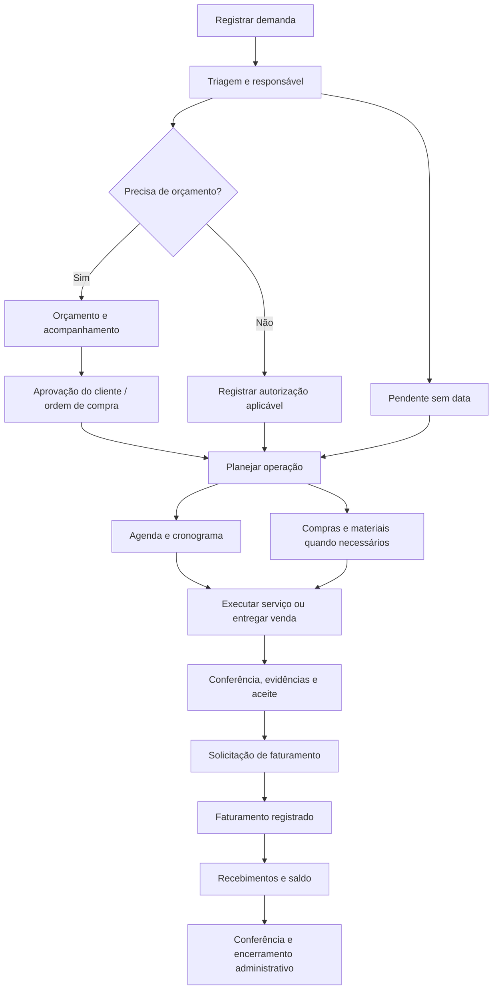

# Estudo — gestão operacional, agenda, cronogramas, compras e financeiro

Registro: 16/09/2026. Nome de trabalho: **Central de Gestão Operacional**.

Atualização de escopo em 17/09/2026: incluído módulo de recebimento de equipamentos, manutenção, guarda, transporte e devolução com evidências e ciência assinada (seção 20). Permanece como planejamento, sem início de desenvolvimento.

**Status: PENDÊNCIA FUTURA — NÃO INICIAR O DESENVOLVIMENTO.**

O usuário solicitou registrar e estudar a proposta, mas não poderá acompanhar sua execução agora. Este documento autoriza somente planejamento e documentação. Não criar projeto remoto, banco, telas, integrações, gatilhos, notificações ou migrações até a retomada expressa.

## 1. Objetivo e decisões já tomadas

Centralizar a operação para que nenhuma demanda, compromisso, compra ou cobrança dependa da memória de uma pessoa. Todo chamado técnico e toda pendência operacional devem ter registro, responsável, situação e próximo passo. Outra pessoa autorizada precisa conseguir assumir o atendimento e continuar de onde ele parou.

Decisões do usuário:

- Na retomada, começar em **um novo projeto no Google Apps Script**.
- Construir e validar antes de decidir se será um sistema independente ou um módulo do SGO+.
- Usar agenda multiuso para todos os colaboradores, com alertas, banners, cores, periodicidade e dashboard.
- Cadastrar os chamados existentes com as datas já conhecidas. O que surgir sem data fica explicitamente **pendente de agendamento**.
- Controlar cronogramas solicitados pelos clientes a partir da aprovação da ordem de compra, identificando datas, equipamentos e serviços.
- Abranger compras, serviços, vendas, custos, despesas, entregas, rastreio, orçamentos pendentes, pedidos de faturamento e recebimentos.
- Produzir relatório mensal consolidado em HTML, preparado para A4, com interpretação por IA, indicadores, gráficos e tabelas.
- Não começar a implementação agora.

As regras detalhadas a seguir são propostas para validação futura; não representam decisões comerciais ou financeiras já aprovadas.

## 2. Princípios de funcionamento

1. **Registrar antes de executar:** todo chamado precisa entrar no sistema; urgências terão um cadastro mínimo rápido e posterior complementação.
2. **Pendência visível:** ausência de data não esconde a demanda. Ela aparece em fila própria, com responsável e próxima revisão.
3. **Uma informação de referência:** orçamento, aprovação, cronograma, execução, compras e financeiro ficam relacionados por identificadores estáveis.
4. **Responsável principal e continuidade:** cada demanda tem um responsável, participantes e substituto quando aplicável. Trocar o responsável preserva todo o histórico.
5. **Situações independentes:** serviço executado não significa compra entregue, faturamento emitido ou dinheiro recebido.
6. **Histórico verificável:** alterações de prazo, valor, responsável e aprovação registram autor, data e motivo.
7. **Visibilidade conforme o trabalho:** colaboradores acessam o necessário; valores sensíveis e aprovações têm permissões específicas. Centralização não significa acesso irrestrito.
8. **Sem falsa conclusão:** pendências impeditivas precisam ser resolvidas ou dispensadas por pessoa autorizada, com justificativa.

## 3. Escopo funcional

| Área | O que precisa controlar |
|---|---|
| Entrada de demandas | Chamados técnicos, atividades internas, solicitações comerciais, vendas e pendências administrativas |
| Agenda compartilhada | Compromissos por colaborador, equipe, cliente, unidade e recurso; previsão e confirmação |
| Periodicidade | Frequência prevista, próxima ocorrência, vencimento, cumprimento e atraso de atividades recorrentes |
| Orçamentos | Solicitação, preparação, envio, acompanhamento, revisões, aprovação parcial/total e recusa |
| Aprovação do cliente | Ordem de compra ou outro documento aceito, valor, itens autorizados, condições e anexos |
| Cronogramas | Etapas, datas, equipamentos, serviços, dependências, responsáveis e versão enviada ao cliente |
| Execução | Missões, tarefas, checklists, evidências, impedimentos, materiais, conclusão técnica e aceite |
| Recebimento e devolução de equipamentos | Protocolos de entrada/saída, avarias, peças e acessórios, manutenção, transferências de responsabilidade e ciência assinada do cliente |
| Compras | Requisição, cotação, aprovação, fornecedor, pedido, custo, entrega, rastreio e recebimento |
| Vendas | Itens vendidos, quantidade, fornecedor/estoque, entrega, aceite e faturamento |
| Custos e despesas | Previsto, comprometido e realizado por operação; origem, comprovante e rateio |
| Faturamento | Solicitação, validação, emissão registrada, documentos e bloqueios |
| Recebimentos | Parcelas, vencimentos, pagamentos parciais, saldo, atraso, cobrança e conciliação |
| Gestão | Dashboard, pendências por pessoa, gargalos, carga de trabalho e indicadores |
| Relatórios | Consolidação mensal HTML A4, gráficos, tabelas e interpretação por IA |

## 4. Fluxo completo da operação

O fluxo admite exceções configuradas: atendimento contratual, urgência autorizada, adiantamento, faturamento por etapa, venda sem serviço e compra que atende mais de uma operação. A exceção deve ficar registrada; não deve obrigar a inventar documentos ou etapas que não existem.

### Estados propostos, separados por dimensão

| Dimensão | Estados principais |
|---|---|
| Demanda | Nova, em triagem, aguardando informação, em andamento, suspensa, concluída, cancelada |
| Comercial | Não se aplica, orçamento a elaborar, enviado, aguardando aprovação, aprovado parcialmente, aprovado, recusado |
| Agendamento | Sem data, previsão, aguardando confirmação, confirmado, reagendamento necessário, realizado, cancelado |
| Execução | Não iniciada, em execução, impedida, parcialmente executada, concluída tecnicamente, aguardando aceite, aceita |
| Compra | Solicitada, em cotação, aguardando aprovação, pedido emitido, em transporte, recebida parcialmente, recebida, divergência/devolução, cancelada |
| Faturamento | Não solicitado, solicitado, em conferência, bloqueado, faturado parcialmente, faturado, cancelado |
| Recebimento | A vencer, recebido parcialmente, recebido, vencido, em negociação, estornado |

“Atrasado” deve ser calculado pelo prazo aplicável, mantendo visível a situação real. Uma demanda pode estar tecnicamente concluída e ainda aguardar faturamento ou recebimento.

## 5. Agenda multiuso e atividades sem data

- Visões diária, semanal, mensal e lista; filtros por colaborador, equipe, cliente, unidade, atividade, prioridade e situação.
- Separar **data prevista** de **data confirmada**, com indicação visual e legenda.
- Exibir compromissos com início/fim, local, equipe, equipamentos, contato do cliente e vínculo com a demanda.
- Manter painel “Sem agendamento”, ordenável por prioridade, idade da solicitação e compromisso assumido.
- Todo item sem data recebe responsável e data de próxima revisão, quando definida; isso não inventa a data do atendimento.
- Sinalizar sobreposição de técnico, veículo ou recurso e considerar deslocamento quando necessário.
- Permitir atividades compartilhadas com vários participantes, sem criar chamados duplicados.
- Registrar reagendamento, motivo, solicitante e impacto no cronograma; preservar a data originalmente combinada.
- Incluir férias, ausências, reuniões, entregas e atividades internas como categorias distintas.
- Cores acompanham texto e ícones; a informação não pode depender só da cor.

### Recorrência e índice de periodicidade

Cadastrar frequência, data-base, regra de próxima ocorrência, antecedência e responsável. Exemplos: manutenção preventiva, calibração, visitas, inspeções e rotinas internas. A frequência deve vir do contrato, planejamento ou definição técnica validada.

Cada ocorrência é um registro próprio, ligado à regra de recorrência. Concluir uma ocorrência não apaga a anterior. Alterar a periodicidade vale para as próximas ocorrências, com histórico.

Proposta de indicador: **cumprimento da periodicidade = ocorrências devidas no período concluídas dentro do prazo ÷ ocorrências devidas no período × 100**. Se não houver ocorrências devidas, mostrar “não se aplica”. Definir na retomada como cancelamentos autorizados e mudanças contratuais entram no cálculo.

## 6. Alertas, banners e acompanhamento

Alertas propostos: chamado sem responsável, item sem data há muito tempo, prazo próximo, atraso, conflito de agenda, orçamento sem retorno, compra aguardando aprovação, entrega atrasada, execução impedida, faturamento pendente e parcela vencida.

- Cada alerta informa o fato, o responsável, o prazo e a ação para resolver.
- Banner geral para avisos de equipe; alerta individual para responsabilidade específica.
- Classificar por criticidade; permitir confirmar leitura, adiar com motivo e resolver pela conclusão da ação correspondente.
- Definir escalonamento ao gestor quando houver atraso ou falta de tratamento.
- Evitar repetir a mesma notificação a cada atualização. Registrar tentativas, entrega e falha quando houver canal externo.
- Canais iniciais propostos: dentro do sistema. E-mail, Google Calendar e mensageria ficam como opções futuras, dependentes de escolha, integração e autorização.

## 7. Gerenciador de cronogramas para clientes

Separar a **ordem de compra do cliente**, que autoriza serviços/vendas, do **pedido de compra ao fornecedor**, que adquire materiais ou serviços. São documentos relacionados, mas não intercambiáveis.

Após aprovação do cliente, o sistema deverá permitir montar cronograma com:

- Cliente/unidade, referência da aprovação e versão do orçamento.
- Equipamentos identificados por ID, TAG e série quando disponíveis.
- Serviço a executar em cada equipamento, quantidade e entregáveis previstos.
- Etapas, duração estimada, início/fim previstos, equipe e dependências.
- Condições: liberação de acesso, disponibilidade do equipamento, materiais, parada da unidade e outras obrigações.
- Datas propostas versus confirmadas, responsável pela confirmação e registro do aceite.
- Visão em tabela e linha do tempo; documento HTML A4 para o cliente.

Uma aprovação parcial gera somente os itens autorizados. Revisões posteriores criam nova versão do cronograma, evidenciam mudanças e preservam o que foi enviado anteriormente. O avanço deve ser calculado por tarefas ou pesos definidos, não por percentual digitado sem critério.

## 8. Compras, materiais, custos e vendas

### Compras

Fluxo: necessidade → requisição → cotação quando aplicável → aprovação → pedido → acompanhamento → recebimento/conferência → destinação → conferência financeira.

Registrar fornecedor, itens, quantidades, preço, frete, descontos, demais custos informados, condição de pagamento, previsão de entrega, transportadora, código/link de rastreio e documentos. Permitir entregas parciais, avarias, devoluções e substituições.

Uma compra pode atender serviço, venda, estoque ou despesa interna. Quando atender várias operações, usar tabela de alocação com quantidade/valor e validar que o total distribuído não exceda o comprado. O mesmo custo não pode ser contado duas vezes.

O rastreio começa por registro manual de código, link e atualizações. Integrações automáticas serão avaliadas depois; não presumir acesso a todas as transportadoras.

### Custos e despesas

Separar custo previsto, compromisso assumido e valor realizado. Vincular material, terceiros, deslocamento, hospedagem e outras categorias à operação ou centro de custo. Registrar comprovante, responsável, aprovação e eventual reembolso.

Propor comparação orçamento × realizado e resultado operacional estimado. A fórmula de margem depende da definição futura de impostos, mão de obra e rateios. Não apresentar margem contábil como se estivesse validada.

### Vendas sem serviço

Manter o mesmo acompanhamento comercial e financeiro, substituindo a execução técnica por separação, expedição, entrega e aceite. A compra ao fornecedor pode ser vinculada diretamente ao item vendido.

## 9. Orçamentos, faturamento, recebimento e encerramento

- Orçamento com versões, itens, validade, anexos, data de envio, responsável pelo retorno e próxima ação.
- Aprovação com evidência, data, aprovador identificado, itens e valores autorizados.
- Solicitação de faturamento vinculada aos itens/etapas e documentos exigidos pelo cliente.
- Faturamento por etapa ou parcial sem ultrapassar o saldo autorizado, salvo alteração aprovada.
- Registrar documento fiscal emitido, valor, data, vencimentos e parcelas. **Emissão fiscal automática não integra o escopo inicial proposto**; avaliar necessidade e sistema emissor na retomada.
- Baixa de recebimento com data, valor, comprovante/origem e conferência financeira; suportar pagamentos parciais, retenções, diferenças e estornos com motivo.
- Impedir que um mesmo recebimento seja contabilizado duas vezes. A conciliação deve identificar o que foi apenas informado e o que foi efetivamente conferido.
- Separar encerramento técnico de encerramento administrativo/financeiro.

Checklist de encerramento proposto: escopo realizado ou dispensado; evidências/aceites registrados; materiais e despesas conferidos; faturamento correspondente tratado; recebimentos conciliados ou pendência formalmente assumida; ausência de tarefas impeditivas abertas.

## 10. Continuidade entre colaboradores

Cada operação terá uma ficha com resumo, linha do tempo, pessoas envolvidas, documentos, decisões, pendências, próximos passos, prazos e contatos.

Ao transferir responsabilidade, registrar quem entrega, quem recebe, motivo, o que já foi feito, o que falta, bloqueios e próxima ação. Permitir ciência de quem assume. Documentos devem estar em armazenamento institucional autorizado, ligados ao registro, em vez de depender de arquivos pessoais.

Perfis iniciais propostos: gestor, atendimento/comercial, planejamento, técnico, compras, financeiro e consulta. Uma pessoa poderá acumular funções, respeitando as regras de aprovação definidas. Aprovações e alterações financeiras precisam ser validadas no servidor.

## 11. Dashboard e indicadores

| Indicador proposto | Definição inicial |
|---|---|
| Carteira aberta | Demandas não concluídas nem canceladas, por situação, cliente e responsável |
| Pendências sem data | Demandas que exigem agenda e ainda não têm compromisso confirmado; separar as que têm previsão |
| Idade da pendência | Tempo desde a abertura; exibir também tempo desde a última ação |
| Cumprimento da agenda | Atividades devidas no período realizadas até o prazo ÷ atividades devidas elegíveis |
| Cumprimento da periodicidade | Ocorrências recorrentes devidas concluídas no prazo ÷ ocorrências recorrentes devidas |
| Tempo de atendimento | Tempo entre marcos definidos: abertura, triagem, agendamento, início e conclusão |
| Aprovação comercial | Quantidade/valor aprovado frente aos orçamentos elegíveis; separar coorte de envio e movimento do mês |
| Execução do cronograma | Etapas concluídas e atrasadas, considerando a versão e a linha de base acordadas |
| Entregas de compras no prazo | Itens/entregas devidos recebidos no prazo ÷ itens/entregas devidos; definir tratamento parcial |
| Desvio de custo | Custo realizado − custo previsto; percentual somente quando a base prevista for maior que zero |
| Faturamento pendente | Itens elegíveis ainda não faturados e valor correspondente |
| Recebíveis | Saldo a vencer e vencido, separado por cliente e faixas de atraso |
| Completude operacional | Operações encerradas com checklist completo ÷ operações encerradas elegíveis |

Fixar definições, unidade, fuso horário, período, regras de exclusão e denominador antes de implementar. Informar “sem base” quando necessário. Separar métricas de quantidade e valor; não misturar compras da empresa com receita de clientes.

## 12. Relatório mensal consolidado em HTML A4 com IA

Conteúdo proposto:

1. Identificação, período, data de corte, escopo e filtros.
2. Resumo executivo: entregas, pendências, riscos e decisões necessárias.
3. Chamados, agenda, recorrência e cumprimento de cronogramas.
4. Orçamentos, aprovações e carteira comercial.
5. Compras, custos, entregas e divergências.
6. Faturamento, recebimentos e saldos.
7. Indicadores e comparação com períodos anteriores disponíveis.
8. Gráficos de evolução, distribuição por situação e principais gargalos.
9. Tabelas de pendências prioritárias, com responsável, prazo e próxima ação.
10. Interpretação por IA e plano de ação sugerido para revisão do gestor.

Os números e gráficos devem vir de cálculos determinísticos sobre um retrato do período. A IA recebe os dados consolidados, explica tendências e sugere ações; não inventa valores, não altera registros nem aprova decisões. Diferenciar fato, hipótese e recomendação. Sem histórico suficiente, declarar a limitação.

Guardar período, versão dos indicadores, data de corte, dados consolidados usados e revisão do texto. Reprocessamentos geram nova versão. Se a IA falhar, o relatório numérico continua disponível e a interpretação pode ser reprocessada.

Requisitos de apresentação: HTML de impressão com formato A4, margens consistentes, cabeçalhos de tabela repetidos, quebras de página adequadas e gráficos legíveis. Validar documentos curtos e longos. Impressão/salvamento em PDF poderá usar a versão HTML validada; decidir depois se haverá geração e arquivamento automáticos.

## 13. Modelo de informações proposto

| Entidade | Relações principais |
|---|---|
| Pessoa/equipe/permissão | Responsabilidades, participação, agenda e aprovação |
| Cliente/unidade/equipamento | Contexto da demanda, do orçamento e da execução |
| Demanda/operação | Registro central que liga o fluxo completo |
| Tarefa/compromisso/recorrência | Ações, datas, participantes e ocorrências |
| Orçamento/versão/item | Proposta comercial e escopo |
| Aprovação do cliente/item aprovado | Autorização e saldo de escopo/valor |
| Cronograma/versão/etapa/dependência | Planejamento, linha de base e avanço |
| Execução/evidência/aceite | Trabalho realizado e comprovação |
| Protocolo de equipamento/item conferido/movimentação | Estado na entrada/saída, acessórios, peças, localização e responsável pela guarda |
| Intervenção/peça retirada/teste | Histórico de manutenção, autorização, peças substituídas e destino das retiradas |
| Relatório de equipamento/versão/ciência | Evidências, documento apresentado, assinatura, ressalvas e comprovante de disponibilização |
| Requisição/cotação/pedido/item de compra | Aquisição e autorização interna |
| Entrega/item recebido/divergência | Recebimentos físicos e rastreio |
| Alocação de compra/custo/despesa | Distribuição entre serviços, vendas e centros de custo |
| Solicitação de faturamento/documento/parcela | Cobrança e saldo a faturar |
| Recebimento/alocação/conciliação | Baixa, saldo e conferência |
| Anexo/comentário/histórico/alerta | Continuidade e rastreabilidade |
| Fechamento mensal/relatório | Retrato do período e versão da análise |

Usar IDs estáveis e relações explícitas. CNPJ, TAG, número de documento e código de rastreio são identificadores textuais, preservando zeros. Datas sem agendamento permanecem vazias com situação própria. Valores monetários devem ter regra explícita de precisão e arredondamento.

Não usar apenas nome como chave. A identidade de uma unidade física não pode ser decidida somente pelo CNPJ: a auditoria atual encontrou endereços e agrupamentos que exigem confirmação. Definir as regras de duplicidade por entidade antes da carga inicial.

## 14. Arquitetura inicial a avaliar na retomada

Hipótese de trabalho: aplicação web em Google Apps Script, com interface, regras de negócio, persistência, permissões, relatórios e integrações separados. Banco e armazenamento de anexos próprios para o piloto, sem escrever na produção do SGO+.

Google Sheets poderá ser avaliado como armazenamento inicial, **não como escolha irrevogável**. Antes da implementação, verificar documentação vigente, volume de registros, quantidade de usuários simultâneos, limites de execução, gatilhos, armazenamento e alternativas de banco. Este estudo não fixa cotas, preços nem capacidade garantida.

Requisitos técnicos a validar:

- Autenticação, autorização por ação e trilha de auditoria.
- Concorrência, prevenção de duplo envio, IDs únicos e tratamento de gravações parciais.
- Operações financeiras e mudanças de situação com validação no servidor.
- Paginação e consultas por período; evitar carregar toda a operação em cada tela.
- Processamento de relatórios e notificações com controle de tentativa, erro e reexecução.
- Separação entre desenvolvimento, homologação e produção, com dados de teste e plano de reversão.
- Configuração e credenciais fora do código público; anexos e relatórios com permissões adequadas.
- Backup e teste de restauração antes do piloto operacional.

Para futura integração com SGO+, definir quem é o sistema de referência para cada cadastro, mapear IDs e evitar sincronização bidirecional sem regras. Avaliar reaproveitamento dos módulos existentes de OS, missões, cronogramas e financeiro após inventariar suas funções reais. Não importar automaticamente defeitos, duplicatas ou dados antigos para o projeto novo.

## 15. Carga inicial e saneamento

1. Levantar chamados em andamento, datas já combinadas, orçamentos pendentes, compras abertas e valores a faturar/receber.
2. Montar planilha de preparação com ID/origem, cliente, unidade, equipamento, descrição, responsável, situação, datas conhecidas e próxima ação.
3. Marcar explicitamente informações ausentes; não adivinhar datas, aprovações, valores ou responsáveis.
4. Revisar duplicidades e vínculos antes de importar, preservando a origem e o histórico necessário.
5. Executar simulação de importação com totais e erros por linha.
6. Homologar amostra, importar por lote rastreável e conferir totais por entidade e valores financeiros.
7. Definir data de corte, forma de registrar novas demandas durante a transição e responsáveis pela conferência.

Chamados sem data entram na fila de agendamento. Datas já confirmadas entram como confirmadas somente com a origem dessa informação registrada. Saldos iniciais devem ser reconciliados para não duplicar faturamento ou recebimento histórico.

## 16. Etapas propostas para execução futura

Não há datas ou estimativas fechadas: dependem da disponibilidade do usuário e do levantamento de volume e integrações.

| Etapa | Entrega | Critério para avançar |
|---|---|---|
| 0 — Retomada | Validar este estudo, nomear responsável pelo produto e escolher operação piloto | Usuário autoriza iniciar e confirma prioridades |
| 1 — Desenho operacional | Fluxos, permissões, estados, regras de duplicidade e dicionário de dados | Exemplos reais percorrem o fluxo sem informação implícita |
| 2 — Protótipo | Telas navegáveis de demanda, agenda, ficha da operação e dashboard | Usuários conseguem registrar, localizar e transferir uma demanda |
| 3 — Primeiro módulo operacional | Chamados, responsáveis, pendências sem data, agenda, alertas internos e histórico | Toda demanda piloto aparece com situação e próximo passo |
| 4 — Comercial e cronograma | Orçamentos, aprovação do cliente, planejamento por equipamento e HTML A4 | Cronograma corresponde ao escopo autorizado e mantém versões |
| 5 — Execução e compras | Tarefas, evidências, materiais, pedidos, entregas e custos | Serviço/venda rastreável até seus materiais e despesas |
| 5A — Equipamentos sob responsabilidade da empresa | Recebimento, manutenção, guarda, transferências, devolução e relatórios assinados | Entrada e saída comparáveis, peças rastreáveis e ciência vinculada ao documento apresentado |
| 6 — Faturamento e recebimento | Solicitações, documentos, parcelas, conciliação e encerramento | Saldos conferem e pendências financeiras não desaparecem |
| 7 — Gestão consolidada | Indicadores e relatório mensal HTML A4 com interpretação por IA | Totais reproduzíveis, texto revisável e impressão validada |
| 8 — Piloto integrado | Carga controlada, uso por equipes, treinamento e ajustes | Operação real acompanhada do início ao encerramento |
| 9 — Decisão de produto | Avaliar sistema independente versus módulo SGO+ | Decisão baseada no piloto, manutenção, acesso e integrações |

O primeiro módulo reduz a dependência da memória; não representa a entrega de todo o escopo. Compras e financeiro devem ser planejados desde o modelo inicial, mesmo entrando em etapas posteriores.

O módulo de equipamentos da etapa 5A foi solicitado em 17/09/2026 por problemas concretos de divergência com clientes. Na retomada, avaliar antecipá-lo no piloto. Essa prioridade de avaliação não autoriza iniciar agora.

## 17. Cenários obrigatórios de aceitação

- Chamado sem data é cadastrado, recebe responsável e continua visível até ser agendado.
- Chamado com data já combinada aparece na agenda das pessoas envolvidas.
- Duas pessoas tentam salvar a mesma solicitação; o sistema evita duplicação ou informa o conflito.
- Reagendamento preserva histórico e atualiza alertas e cronograma correspondente.
- Colaborador substituto assume uma missão com acesso ao contexto e às pendências.
- Aprovação parcial gera somente os serviços/equipamentos autorizados.
- Compra com duas entregas mantém quantidade pendente correta e registra divergência.
- Uma compra atende duas operações sem duplicar custos.
- Venda sem serviço percorre entrega, faturamento e recebimento sem exigir execução técnica fictícia.
- Serviço concluído continua visível como pendente de faturamento ou recebimento.
- Recebimento parcial reduz o saldo; estorno recompõe o saldo com histórico.
- Atividade recorrente gera a próxima ocorrência sem duplicar a anterior.
- Falha de notificação ou IA fica registrada e permite nova tentativa sem duplicar registros.
- Relatório mensal reproduz os totais das consultas com os mesmos filtros e período.
- Relatório A4 longo não corta tabelas ou gráficos essenciais.
- Usuário sem permissão não aprova compras nem altera recebimentos por chamada direta à API.
- Backup é restaurável e importação pode ser conferida por lote.
- Equipamento recebido com avaria tem fotos, descrição, acessórios e ciência vinculados ao protocolo de entrada.
- Peça retirada durante a manutenção tem responsável, motivo, foto e destino registrados.
- Devolução compara os itens e o estado com a entrada e destaca qualquer divergência antes da conclusão.
- Assinatura de motorista registra a entrega física e sua função; não é convertida automaticamente em aceite técnico do cliente.
- Cliente pode registrar ressalvas; recusa ou ausência de assinatura permanece visível como pendência, sem ciência fictícia.
- Documento assinado não muda silenciosamente; correção gera nova versão e nova ciência quando aplicável.
- Falha no envio de foto impede tratar aquela evidência como salva; falha da IA não impede documentar o recebimento.

## 18. Decisões a resolver somente quando o projeto for retomado

1. Equipes participantes, quantidade de usuários, volume e responsável pelo projeto.
2. Diferença prática entre chamado, atividade, OS, missão e operação na empresa.
3. Aprovações necessárias, alçadas por valor e tratamento de urgência.
4. Tipos de serviço/venda, contratos, recorrências e compromissos com clientes.
5. Fontes de chamados existentes e critério de cadastro mestre de clientes/unidades/equipamentos.
6. Agenda somente interna ou também integrada ao Google Calendar; canais e frequência de alertas.
7. Necessidade de estoque, reservas e movimentação de materiais versus compra direta para operação.
8. Sistema fiscal/financeiro existente, forma de conciliação e responsabilidades do financeiro.
9. Regras de custo, rateio, margem, retenções e faturamento parcial.
10. Modelo visual do cronograma e do relatório mensal; indicadores que a direção realmente usará.
11. Fonte/serviço de IA, dados que podem ser enviados, revisão humana e custo aceitável.
12. Critérios de sucesso do piloto e decisão posterior sobre integração ao SGO+.
13. Fluxo real de retirada/recebimento/devolução de equipamentos, pessoas autorizadas a assinar, requisitos de evidência e tratamento de recusa/ausência.
14. Modalidade de assinatura, identificação do signatário, texto de ciência, armazenamento e retenção das evidências; submeter os termos e o procedimento à revisão jurídica antes de usar como instrumento de respaldo.

Não solicitar essas respostas agora: o usuário pediu deixar salvo para avaliar quando puder dedicar atenção.

## 19. Instrução de continuidade

Ao retomar, ler este documento e `PENDENCIAS_PROJETO.md`. Confirmar que o usuário está autorizando iniciar, revisar as decisões pendentes e escolher um piloto pequeno. Somente depois criar o novo projeto no Google Apps Script. **Não transformar este registro de pendência em autorização automática para desenvolvimento ou alterações no SGO+.**

## 20. Módulo de recebimento, manutenção e devolução de equipamentos

**Solicitação adicional do usuário — 17/09/2026. Status: pendência futura, sem implementação autorizada neste momento.**

### Problema e resultado esperado

O usuário relatou reclamações de clientes sobre equipamentos danificados ou devolvidos sem peças, acompanhadas de relatos verbais de funcionários de que teriam mostrado a situação ao motorista, sem documentação. O sistema deverá registrar o que foi recebido, em que estado, por quem, quais intervenções ocorreram e exatamente o que foi devolvido.

Objetivo: permitir reconstruir a história do equipamento com evidências e ciência das partes, reduzindo divergências e informações apenas verbais. A ferramenta apoia a documentação e a rastreabilidade; não deve prometer eliminar disputas nem atribuir validade jurídica automática a uma assinatura ou relatório gerado por IA. A definição dos termos e da modalidade de assinatura fica para revisão especializada na implantação.

### Fluxo proposto

Solicitação/retirada → conferência na origem quando houver → transporte → recebimento e inspeção de entrada → ciência do cliente → diagnóstico → autorização de intervenção → manutenção → testes finais → conferência de saída → transporte/entrega → ciência de recebimento da devolução → encerramento ou tratamento de divergência.

Cada recebimento gera um protocolo próprio vinculado ao equipamento e à operação/OS. Um retorno do mesmo equipamento gera novo protocolo ligado ao atendimento anterior, sem substituir o histórico.

### A. Recebimento e inspeção de entrada

- Número do protocolo, data/hora do evento e do registro, cliente, unidade, operação/OS e motivo do envio.
- Identificação do equipamento: tipo, fabricante, modelo, TAG, série e foto da identificação. Se ilegível ou ausente, registrar a limitação e usar identificação provisória, sem inventar série.
- Quem entregou e quem recebeu, suas funções e empresas; distinguir cliente, representante, motorista, transportadora e funcionário interno.
- Relato do cliente separado das observações feitas pela equipe. Registrar quem fez cada declaração.
- Checklist por tipo de equipamento: estado externo, partes visíveis, embalagem, lacres, avarias, marcas, trincas, componentes soltos, corrosão ou outros achados.
- Inventário de peças e acessórios entregues, com descrição, quantidade, identificação quando houver e estado: cabos, fontes, sensores, bandejas, suportes, tampas, manuais e demais itens aplicáveis.
- Fotos gerais, identificação, acessórios e detalhes de avarias. Captura orientada, com revisão da legibilidade e confirmação do envio ao servidor.
- Estado funcional: testado e resultado observado, não testado ou teste inviável, com motivo. “Não testado” nunca significa “funcionando”.
- Condições de segurança, limpeza/descontaminação e restrições de manuseio quando aplicáveis, com orientação técnica definida no checklist.
- Pendência para itens que não puderem ser conferidos, como volumes fechados; inspeção complementar gera registro posterior identificado, sem retroagir ao momento da entrada.

Gerar **relatório de recebimento** com texto, imagens, itens recebidos, avarias, limitações e relatos. Apresentar para ciência do cliente ou representante identificado. A conferência do motorista pode ser registrada como evento adicional, sem presumir que ele esteja autorizado a aprovar diagnóstico ou serviço.

### B. Guarda e transferências de responsabilidade

Toda movimentação relevante registra origem, destino, localização, equipamento/volumes, quem entrega, quem recebe, data/hora, condições e observações. Abranger transportadora, motorista, recepção, bancada, setor, terceiro e entrega ao cliente.

Mostrar o responsável atual pela guarda e a última localização confirmada. Movimentação iniciada e ainda não confirmada pelo recebedor fica pendente. Dano ou falta identificados durante transferência geram ocorrência com fotos e notificação ao gestor.

O registro verbal “mostrei ao motorista” não conclui a etapa: deve haver evento documentado com o relato, identificação dos envolvidos e evidência disponível. Se não houver confirmação da outra parte, indicar expressamente essa ausência.

### C. Registro de manutenção

- Diário de intervenções com técnico, data/hora, diagnóstico, procedimento e referência da autorização.
- Fotos antes, durante e depois das intervenções relevantes.
- Peças retiradas, instaladas, substituídas ou enviadas a terceiros, incluindo quantidade, identificação, motivo e responsável.
- Destino das peças retiradas: armazenada, devolvida ao cliente, enviada para análise ou descarte autorizado. Não presumir descarte nem considerar a peça desaparecida apenas porque foi substituída.
- Serviços adicionais e mudanças de escopo dependem de autorização registrada conforme as regras futuras de aprovação.
- Testes executados, condições, resultados, evidências e limitações; distinguir reparado, não reparado, aguardando peça, condenado mediante parecer e devolvido sem reparo.
- Relacionar compras, materiais e custos ao atendimento sem misturar patrimônio do cliente com estoque próprio.

### D. Conferência de saída e registro de entrega

Gerar comparação **recebido × devolvido** por equipamento, peça e acessório, mostrando quantidade, condição inicial, condição final e justificativa de diferença. Permitir devolução parcial com saldo ainda sob guarda da empresa.

- Checklist final com técnico e responsável pela liberação, testes realizados e pendências conhecidas.
- Fotos atuais do equipamento, identificação, acessórios separados e embalagem final; lacres e volumes quando aplicável.
- Relatório dos serviços executados, peças substituídas, peças antigas devolvidas e observações de uso/manuseio efetivamente orientadas.
- Identificação de quem entrega, transporta e recebe, datas e local; comprovantes de cada transferência.
- Registro de ressalvas, avarias ou falta de itens apontados pelo destinatário, com ocorrência vinculada e tratamento posterior.
- Entrega à transportadora e entrega final ao cliente são eventos diferentes. Não marcar “cliente recebeu” apenas porque o motorista retirou.

A conclusão regular exige os registros obrigatórios de conferência e entrega. Quando o fluxo físico precisar continuar sem assinatura, registrar a ocorrência real e abrir uma exceção supervisionada com motivo e responsável; não fabricar aceite nem ocultar a pendência de ciência.

### E. Ciência e assinatura do cliente

Prever ciência separada para **condição de entrada** e **recebimento da devolução**, além das autorizações comerciais/técnicas que forem necessárias. Ciência de uma condição, autorização de reparo e recebimento físico não são a mesma manifestação.

O signatário deve poder visualizar o documento e as imagens antes de assinar e acrescentar ressalvas. Registrar identidade, função, vínculo com o cliente e forma de confirmação escolhida. A modalidade de assinatura e a comprovação de representação serão definidas na retomada; não limitar o desenho a uma imagem de assinatura sem contexto.

Vincular cada manifestação à versão exata do relatório apresentado e ao inventário/fotos que o compõem. Preservar data/hora, trilha do evento e comprovante de disponibilização de cópia ao cliente. Não tratar envio de link, abertura do documento, silêncio ou assinatura de terceiro como assinatura do cliente.

Documento assinado deve permanecer preservado. Correções geram nova versão com motivo, autor e ligação à anterior; alterações de conteúdo relevante exigem nova ciência conforme o procedimento definido. O cliente pode recusar assinatura ou discordar: registrar a situação e as ressalvas, com alerta ao gestor.

### F. Relatórios com IA, imagens e relatos

Entregas propostas: relatório de recebimento, histórico/relatório de manutenção e termo/relatório de devolução, em HTML preparado para A4, com opção futura de PDF e assinatura sobre a versão final.

A IA organiza os relatos e redige uma síntese com base nos registros e imagens selecionados. Cada imagem terá legenda, etapa e referência à evidência original. O relatório deve distinguir observação direta, relato de cliente, relato de funcionário, teste realizado e interpretação sugerida.

Não permitir que a IA invente avarias, acessórios, procedimentos, resultados, assinaturas ou datas, nem conclua quem causou um dano apenas por uma foto. Achados sugeridos a partir de imagens exigem conferência humana. Uma foto de entrada que não mostra determinada área não prova que essa área estava intacta.

O responsável revisa o documento antes de apresentá-lo para assinatura. Depois de assinado, a IA não reescreve aquela versão. Se a IA estiver indisponível, gerar o registro factual por modelo e manter o fluxo documental funcionando.

### G. Integridade das evidências e operação prática

- Preservar arquivos originais e metadados disponíveis. Separar data informada da captura, quando existente, da data de recebimento no servidor.
- Identificar quem enviou a evidência e a qual equipamento, protocolo e etapa pertence.
- Miniaturas, marcações e versões de impressão não substituem o original. Correções e anotações ficam identificadas.
- Não permitir exclusão silenciosa de evidência associada a documento assinado; definir correção, retenção e descarte controlados na implantação.
- Restringir acesso aos registros e coletar apenas dados pessoais necessários ao procedimento. Definir guarda e compartilhamento com revisão jurídica e operacional.
- Prever uso em celular, rascunho e retomada de formulário. Foto ainda local ou com falha de upload não conta como evidência arquivada.
- Avaliar mecanismo de verificação de integridade dos arquivos e documentos; ele complementa a rastreabilidade, sem provar sozinho a autoria ou a veracidade do conteúdo.

### H. Dashboard, alertas e critérios de entrega

Exibir equipamentos sob guarda por local/responsável, tempo desde a entrada, aguardando diagnóstico, autorização, peça ou retirada, devoluções parciais, divergências e ciências pendentes.

Alertar para protocolo incompleto, acessórios sem conferência, movimentação sem confirmação, peça retirada sem destino, relatório sem revisão, entrega sem comprovação e divergência não resolvida. Os indicadores mensais podem incluir tempo de permanência, protocolos completos e ocorrências por etapa, sempre com definição explícita.

Critério principal do piloto: selecionar um equipamento e reconstruir a entrada, seus acessórios, as intervenções, todas as transferências e a devolução, com os documentos efetivamente apresentados e as manifestações registradas. Nenhuma conclusão pode depender apenas da lembrança de um funcionário.

**Próxima ação somente na retomada:** mapear exemplos reais de recebimento/devolução, definir checklists por equipamento, responsáveis e termos de ciência, e validar o procedimento de assinatura. Nenhum projeto, código ou integração deve ser criado agora por causa deste acréscimo.
