<!-- Gerado por output/portal-cliente-20261116/etapa6/gerar-manual-cliente.cjs a partir de SGO_PortalCliente_Manual.js (o mesmo texto do "Manual do Portal" dentro do sistema). Capturas reais do sistema rodando, com dados fictícios. Não edite à mão: mude o texto no legado e gere de novo. -->

# Manual do Portal do cliente

_Edição de 18/11/2026. Metrolabs._

O Portal do cliente é o canal da sua empresa com a Metrolabs para pedir atendimento técnico, acompanhar cada chamado até o relatório final e consultar, a qualquer hora, os documentos, os equipamentos e os vencimentos das suas unidades.

Cada pessoa da empresa tem o próprio acesso, com e-mail e senha individuais. O que cada pessoa vê e pode fazer depende do papel dela no Portal e das unidades liberadas para ela, conforme a tabela abaixo. O papel e as unidades são definidos pela Metrolabs, a pedido do Gestor do cliente.

Este manual segue a ordem do menu do Portal. Os nomes entre aspas são os botões exatamente como aparecem na tela.

| Papel | O que faz no Portal |
|---|---|
| Gestor do cliente | Vê todas as unidades liberadas, abre e acompanha chamados, aprova orçamentos, confirma atendimentos, vê os indicadores, cuida da equipe da empresa no Portal (pede a inclusão de pessoas e desliga acessos). |
| Solicitante | Abre e acompanha chamados das unidades dele, conversa com a Metrolabs, vê documentos, equipamentos e indicadores dessas unidades. Não aprova orçamento. |
| Consulta | Só consulta documentos, equipamentos, vencimentos e chamados das unidades dele. Não abre chamado, não envia mensagem e não aprova orçamento. |

## 1. Entrar no Portal e aceitar o termo de uso

O acesso começa pelo convite que a Metrolabs envia para o seu e-mail de trabalho. O convite tem um link de uso único, com validade, para você criar a sua senha. Se o link vencer, peça um novo ao Gestor do cliente da sua empresa ou à Metrolabs.

**Passo a passo**

1. Abra o e-mail do convite e toque no link para criar a sua senha.
2. Na tela de entrada, escreva o seu e-mail e a senha e toque em "Entrar".
3. Se aparecer o pedido de um código de confirmação, digite os números que chegaram pelo canal indicado na própria tela.
4. No primeiro acesso aparece o "Termo de uso do Portal do cliente". Leia, marque "Li o termo de uso e estou ciente" e toque em "Li e estou ciente". Se não concordar, toque em "Sair do Portal" e fale com a Metrolabs.

> O termo é pedido de novo sempre que o texto mudar. A data e a versão do seu aceite ficam em Minha conta e equipe.

> Esqueceu a senha? Na tela de entrada, use "Esqueci minha senha". A senha nunca é enviada por mensagem.

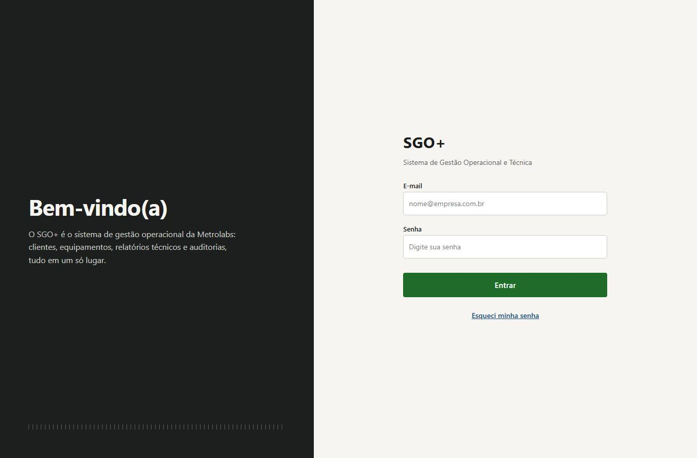

_Tela de entrada do sistema._

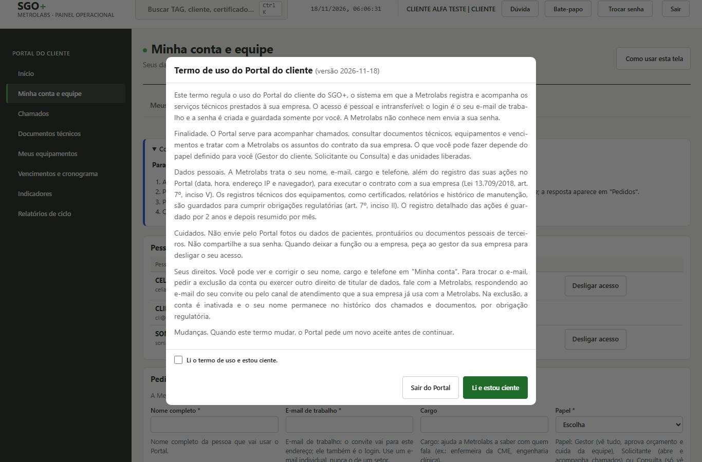

_Termo de uso no primeiro acesso._

## 2. Início

O Início mostra de relance o que está acontecendo com os equipamentos da sua empresa e o que depende de você.

**Passo a passo**

1. Veja os quatro cartões: chamados abertos, próxima visita, vencimentos nos próximos 30 dias e documentos novos desde a sua entrada anterior. Toque num cartão para abrir a tela correspondente.
2. Trate os itens de "O que precisa de você": complemento pedido pela Metrolabs, orçamento aguardando aprovação e atendimento para confirmar.
3. Para um problema novo, toque em "Abrir chamado".
4. Os atalhos levam às outras telas do Portal. "Manual do Portal" abre este manual para ler ou imprimir.

> Se o contrato da sua empresa estiver em período de carência ou em modo consulta, uma faixa no topo explica a situação e o caminho para renovar.

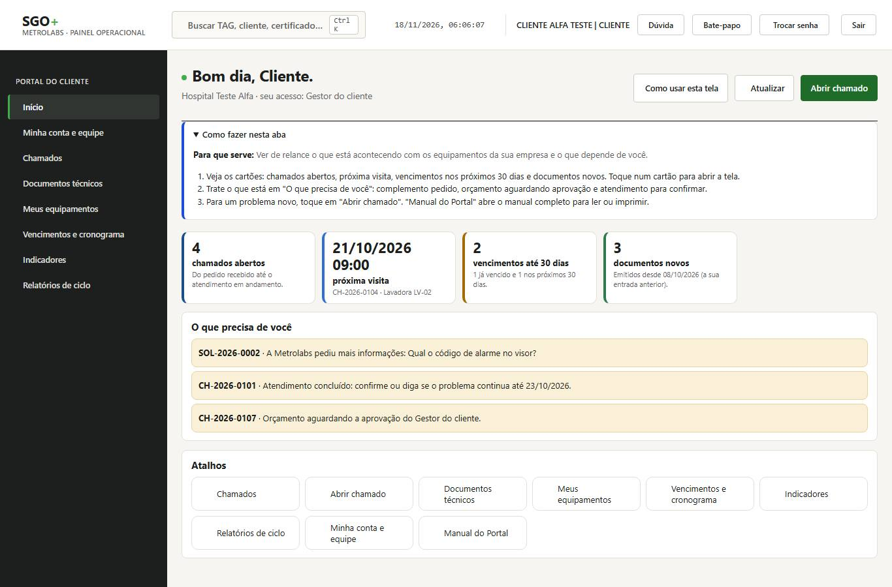

_Início do Portal no computador._

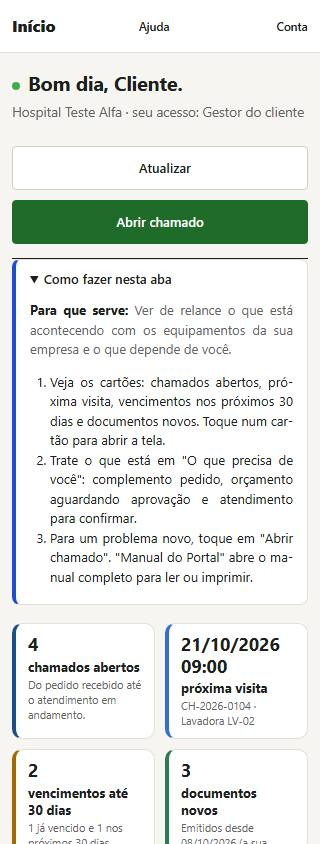

_Início do Portal no celular._

## 3. Abrir um chamado

O chamado é aberto em cinco partes. Quanto mais completo o relato, mais rápido o técnico chega com a peça certa. A Metrolabs define a prioridade pelo que você informa sobre a situação do equipamento e o risco.

**Passo a passo**

1. Abra Chamados e toque em "Abrir chamado" (ou, na ficha do equipamento, em "Abrir chamado para este equipamento").
2. Equipamento: escolha a unidade e o equipamento pela TAG, série ou setor. Se ele não aparece, marque "Equipamento não está na lista" e descreva tipo, marca, modelo, número de série e setor.
3. Problema: descreva o que acontece (pelo menos 30 letras), desde quando, o código que aparece no visor (ou marque "Não exibe código"), a situação do equipamento (parado, funciona com limitação ou funcionando), o risco de continuar usando e o que já foi tentado.
4. Contato no local: quem recebe o técnico, com telefone com DDD e e-mail. Informe também o melhor horário para a visita e, se houver, o número do chamado no sistema da sua empresa.
5. Fotos: envie fotos do equipamento, do visor e da etiqueta, e um vídeo curto, se ajudar. Não fotografe pacientes, prontuários nem documentos de pessoas.
6. Confira o resumo e toque em "Enviar". Se faltar algo, cada campo mostra o que corrigir.

> Se já houver chamado aberto para o mesmo equipamento, o Portal pergunta se é o mesmo problema. "Sim" leva à conversa daquele chamado; "Não" abre o pedido mesmo assim.

> Fora do horário de trabalho da Metrolabs (08:00 às 18:00, dias úteis), o pedido é recebido e analisado no próximo horário útil.

> Com o contrato em modo consulta, o botão vira "Pedir atendimento avulso": o pedido é orçado antes de ser atendido.

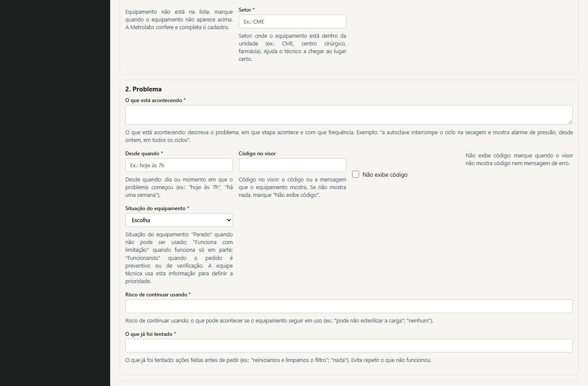

_Formulário de abertura do chamado._

## 4. Acompanhar os chamados

Cada pedido passa por até oito etapas, sempre na mesma ordem. A etapa atual aparece na lista e na ficha, com a explicação do que acontece agora.

| Etapa | O que quer dizer |
|---|---|
| 1. Recebido | A Metrolabs recebeu o pedido e vai analisar. |
| 2. Complemento pedido | A Metrolabs precisa de mais uma informação para seguir. |
| 3. Em análise | A equipe técnica está avaliando o caso. |
| 4. Aguardando sua aprovação | Há orçamento enviado para o Gestor do cliente aprovar. |
| 5. Aguardando peça | O atendimento depende da chegada de uma peça. |
| 6. Visita agendada | A data da visita está marcada; o nome do técnico aparece aqui. |
| 7. Em atendimento | O técnico está no local ou o serviço está em andamento. |
| 8. Concluído | O atendimento terminou; o relatório fica disponível. |

**Passo a passo**

1. Abra Chamados. Filtre por unidade, etapa ou período, ou busque pelo número do chamado (CH-...) ou do pedido (SOL-...), pela série, TAG ou setor.
2. As abas Kanban e Gantt mostram os mesmos chamados por etapa e numa linha do tempo.
3. Toque num chamado para abrir a ficha: relato enviado, etapa, prazo do contrato, data da visita e técnico (só com a visita agendada ou em andamento), ordem de serviço, orçamento, fotos, conversa e linha do tempo.

> Para cancelar, use "Cancelar o chamado" na ficha, com o motivo, antes da saída do técnico para a visita. Depois disso, combine pela conversa.

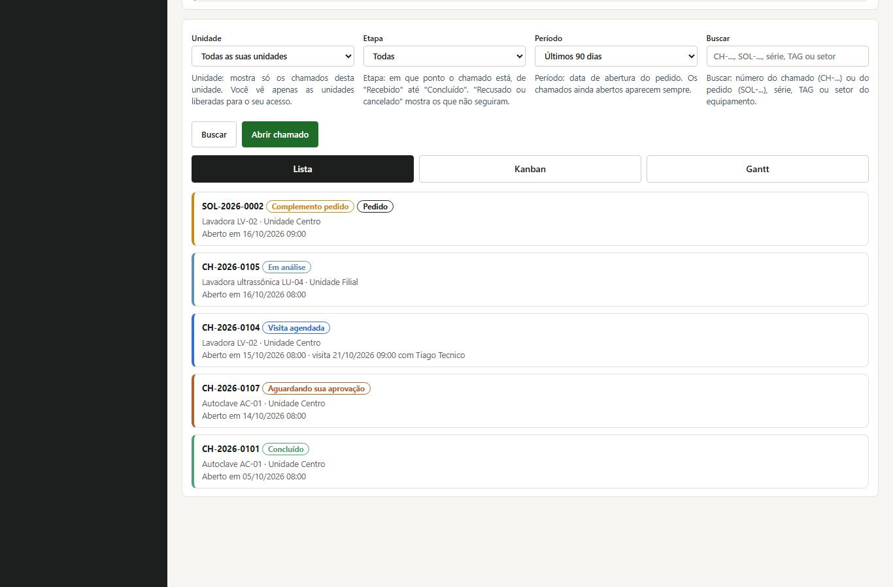

_Lista de chamados com as etapas._

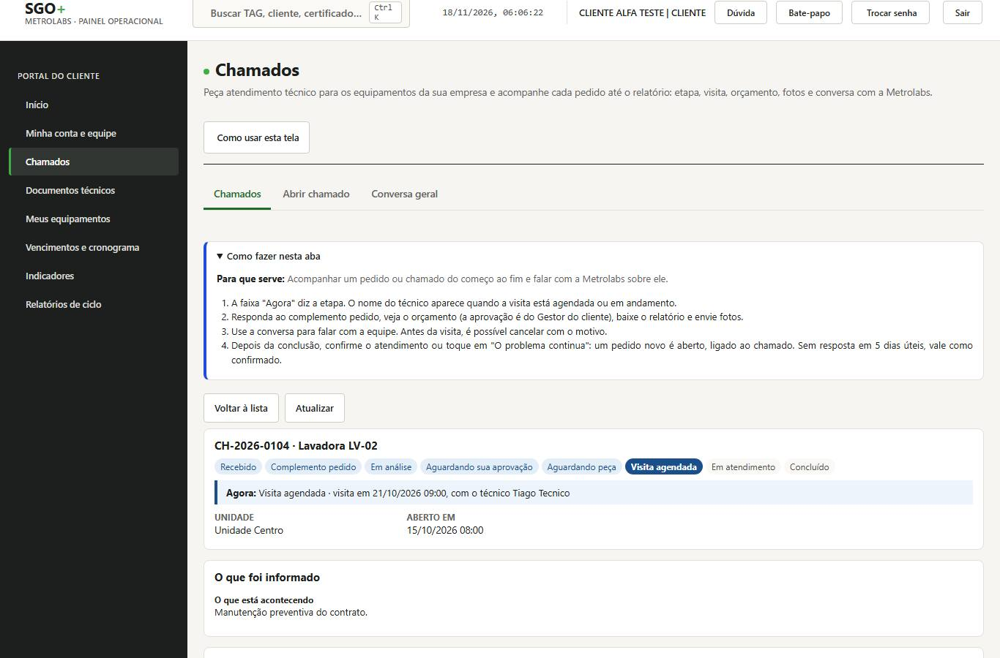

_Ficha do chamado._

## 5. Conversar com a Metrolabs

Cada chamado tem a sua conversa com a equipe da Metrolabs. Para assuntos fora de um chamado (dúvida, documento que falta, correção de cadastro), use a "Conversa geral".

**Passo a passo**

1. Na ficha do chamado, escreva em "Mensagem" e, se quiser, anexe uma foto ou um PDF de até 10 MB.
2. Toque em "Enviar mensagem". A resposta aparece na mesma conversa, no horário de trabalho da Metrolabs.
3. Para a conversa geral, abra Chamados e toque na aba "Conversa geral".

> Não escreva dados de pacientes nas mensagens.

> No papel Consulta, a conversa fica só para leitura.

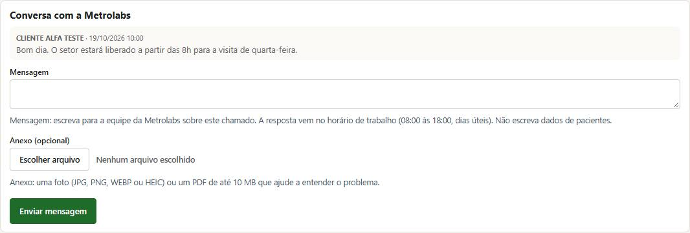

_Conversa na ficha do chamado._

## 6. Aprovar um orçamento (Gestor do cliente)

Quando o atendimento depende de orçamento, o chamado fica na etapa "Aguardando sua aprovação" e o Gestor do cliente recebe um aviso por e-mail. Só o Gestor do cliente responde; para os outros papéis, o orçamento aparece para consulta, com o nome de quem aprova.

**Passo a passo**

1. Abra a ficha do chamado (ou toque no item em "O que precisa de você", no Início).
2. Toque em "Baixar o orçamento em PDF" e confira os itens, os valores e as condições.
3. Para aprovar, toque em "Aprovar", informe nome completo, cargo ou função e, se quiser, o CPF, assine com o dedo ou o mouse, marque que leu e concorda e toque em "Aprovar".
4. Para pedir mudança, toque em "Pedir ajuste" e diga o que precisa mudar. Para recusar, toque em "Recusar" e escreva o motivo.

> A resposta fica registrada com data, hora e protocolo e não pode ser trocada depois. O comprovante fica no chamado.

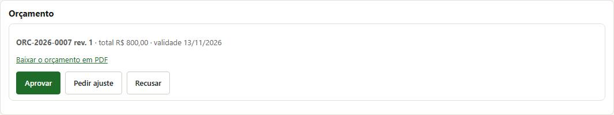

_Orçamento na ficha do chamado._

## 7. Confirmar o atendimento e o relatório

Com a ordem de serviço encerrada e o relatório emitido, a ficha do chamado pergunta se o atendimento resolveu. A sua resposta ajuda a Metrolabs a melhorar.

**Passo a passo**

1. Toque em "Confirmar atendimento"; o comentário é opcional.
2. Se o problema voltou ou não foi resolvido, abra "O problema continua", descreva o que acontece e toque em "Enviar: o problema continua". Um pedido novo é aberto, ligado a este chamado.
3. Para baixar o relatório da ordem de serviço, use o link na ficha. Para o relatório completo do atendimento em A4 (etapas, visita, serviço e fotos liberadas), toque em "Gerar relatório do atendimento". Com o atendimento ainda em andamento, "Ver prévia" mostra como ele está.

> Sem resposta em 5 dias úteis, o atendimento fica confirmado por prazo.

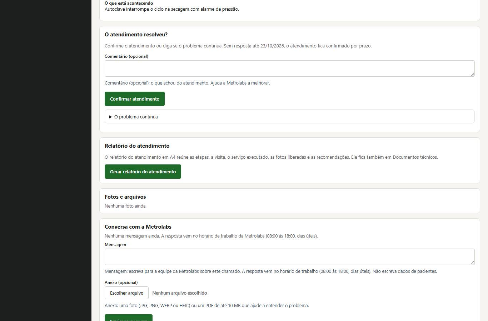

_Confirmação do atendimento e relatório._

## 8. Documentos técnicos

A tela reúne os documentos técnicos dos seus equipamentos para auditorias e para a Vigilância Sanitária: certificados de calibração, relatórios de qualificação, laudos de NR-13, relatórios de atendimento e de ronda, relatórios do ciclo da lavadora e o cronograma de execução.

A aba "Por pastas (prontuário)" mostra todos os documentos da empresa organizados por pasta, como no prontuário do equipamento: inclui PGT e POP, ordens de serviço, qualificações e os demais documentos emitidos para a sua empresa.

**Passo a passo**

1. Na aba "Documentos técnicos", filtre por unidade, equipamento, tipo, data de emissão ou "Vence até", ou busque pelo número, TAG, série ou nome.
2. Toque em "Abrir" para ver o PDF. Versões anteriores ficam guardadas abaixo de cada documento.
3. Na aba "Por pastas (prontuário)", toque numa pasta para abri-la e use a busca e os filtros de unidade e equipamento.

> Se faltar algum documento, avise pela Conversa geral.

> No celular, o documento abre dentro do sistema, com "Voltar" e "Imprimir".

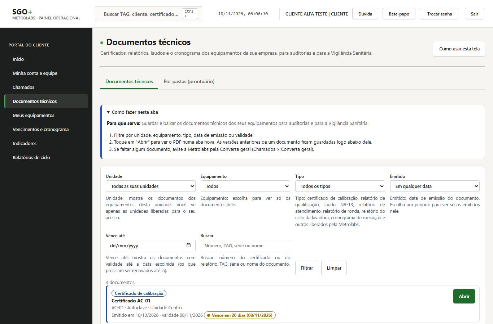

_Documentos técnicos._

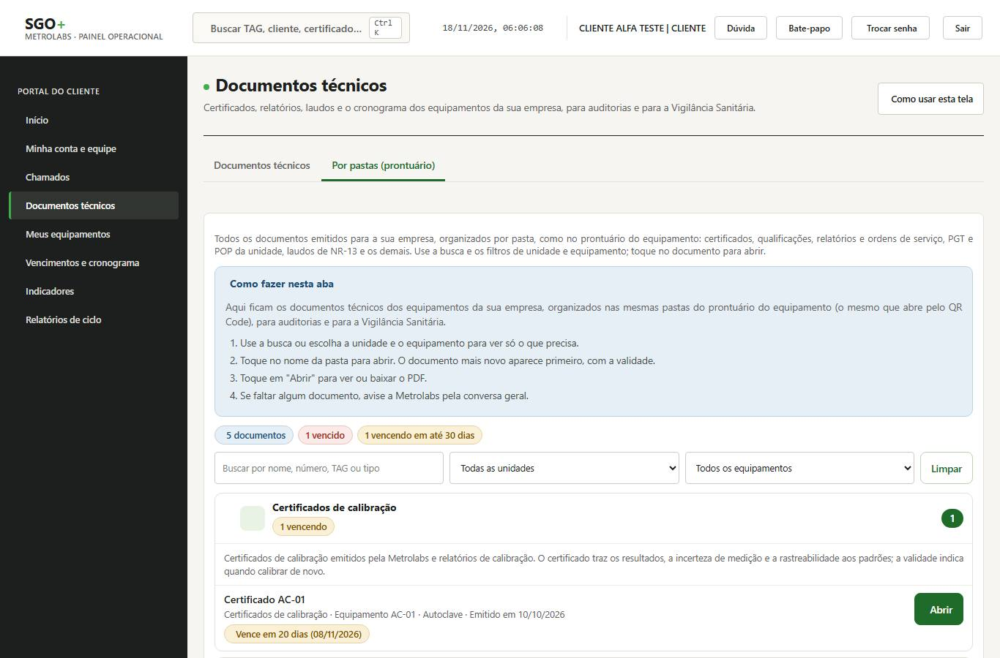

_Documentos por pastas (prontuário)._

## 9. Meus equipamentos e unidades

A lista mostra os equipamentos das suas unidades com um farol por categoria (calibração, qualificação, NR-13 e manutenção): verde em dia, âmbar vence em até 30 dias, vermelho vencido e cinza sem registro.

**Passo a passo**

1. Filtre por unidade ou situação, ou busque pela TAG, série, modelo ou setor. Toque no equipamento para abrir a ficha.
2. A ficha mostra os dados do cadastro, os vencimentos, os documentos, o prontuário por pastas, o histórico dos atendimentos concluídos e os chamados.
3. Em "Informar correção de cadastro", escreva o dado certo e toque em "Enviar à Metrolabs". A equipe corrige o cadastro.
4. A aba "Unidades" lista as unidades da empresa com endereço e quantidade de equipamentos; "Documentos da unidade" abre as pastas da unidade (PGT, POP e registros).

> O QR Code colado no equipamento abre o prontuário dele direto, depois da entrada no Portal.

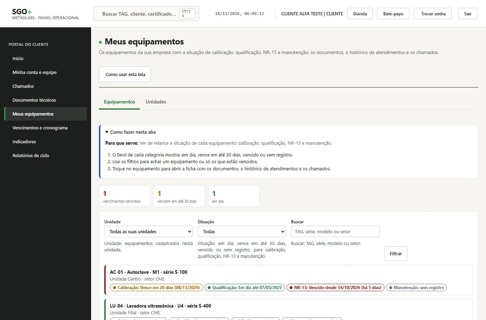

_Meus equipamentos com o farol._

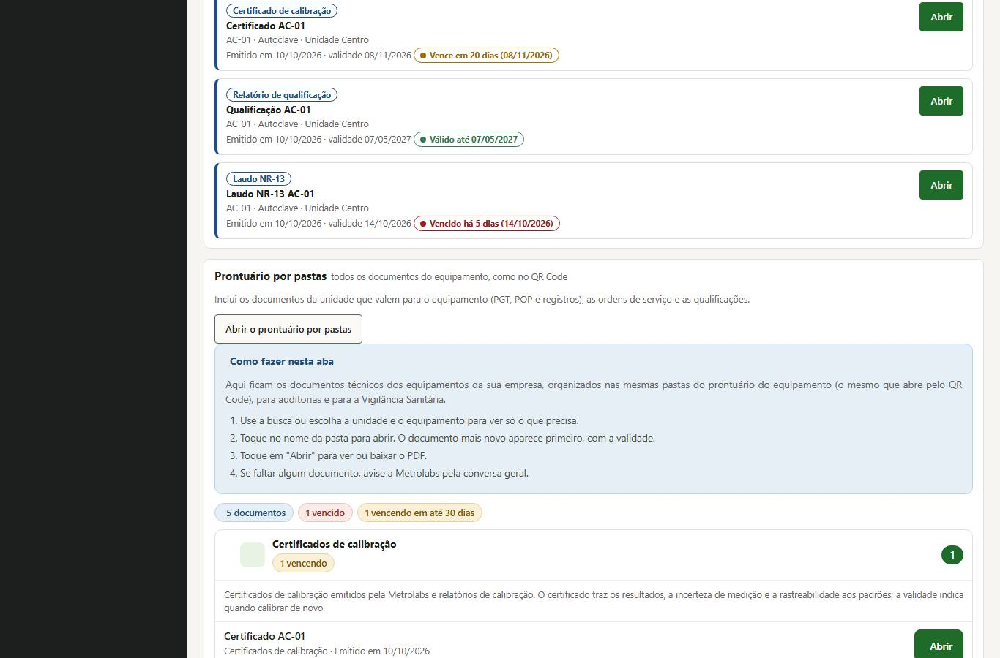

_Ficha do equipamento._

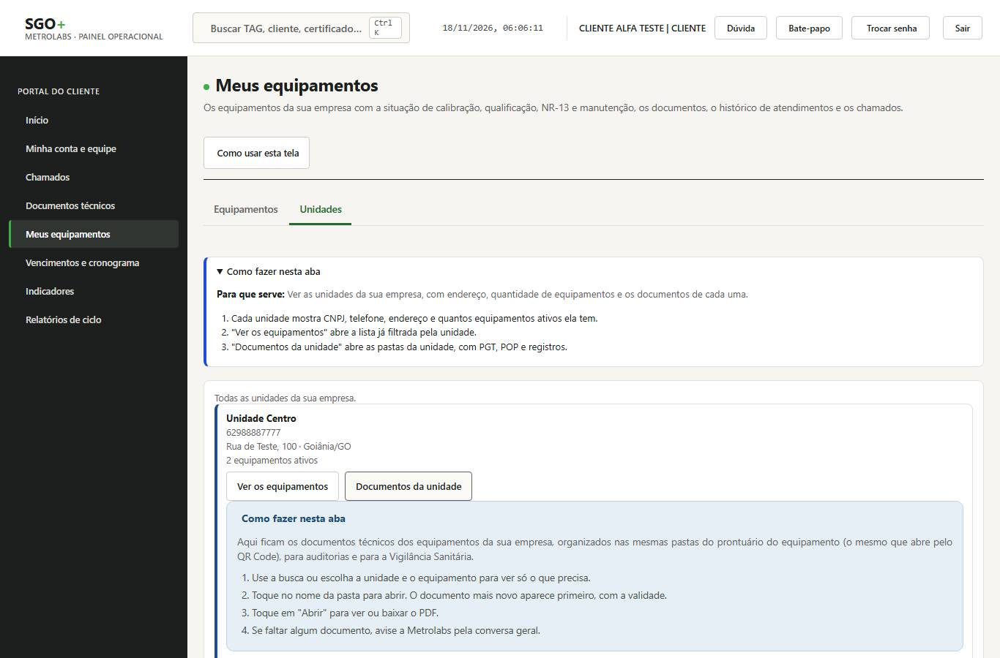

_Unidades da empresa._

## 10. Vencimentos e cronograma

A aba Vencimentos lista, por equipamento e categoria, a data de validade do documento mais recente e quantos dias faltam. A aba Cronograma separa o que está agendado do que está apenas previsto.

**Passo a passo**

1. Em Vencimentos, escolha a unidade, a categoria e a janela (vencidos e os próximos 30, 60 ou 90 dias, ou todos). Toque em "Ver o equipamento" para abrir a ficha.
2. Em Cronograma, "Agendado" mostra visitas, rondas e ordens de serviço com data combinada; "Previsto" mostra a próxima calibração, qualificação, inspeção ou manutenção calculada pela validade dos documentos e pelo contrato; "Documento do cronograma" traz o PDF emitido pela Metrolabs.

> Previsto não é data confirmada. A data só fica confirmada quando aparece em Agendado.

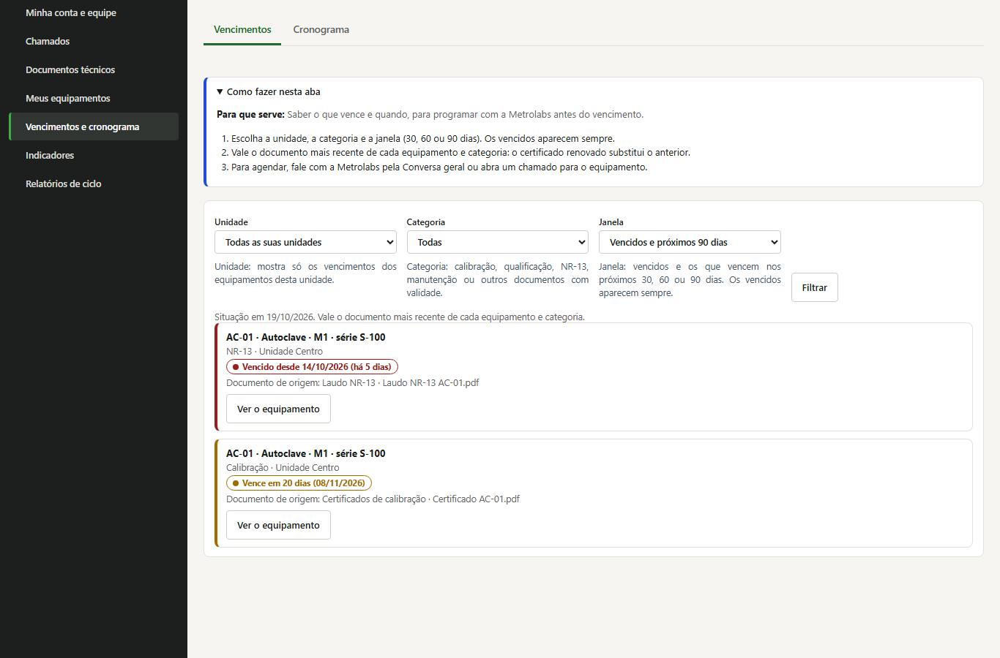

_Vencimentos._

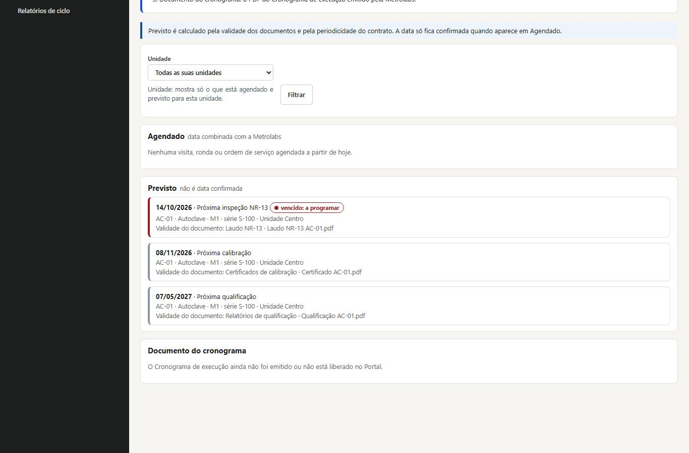

_Cronograma._

## 11. Indicadores e relatório do período

Os indicadores mostram chamados abertos e concluídos, tempo médio até a visita e até a conclusão, atendimento dentro do prazo do contrato, equipamentos em dia, vencimentos e reincidência. Estão disponíveis para o Gestor do cliente (todas as unidades) e para o Solicitante (as unidades dele).

**Passo a passo**

1. Escolha o período (30, 90, 180 ou 365 dias) e, se quiser, uma unidade, e toque em "Mostrar". Cada número traz embaixo "Como é contado".
2. Toque em "Relatório do período (PDF)" para gerar o documento A4 com o mesmo período e a mesma unidade. Os relatórios já gerados ficam na lista logo abaixo.

> Os tempos contam só as horas do expediente, em dias úteis, como o prazo do contrato.

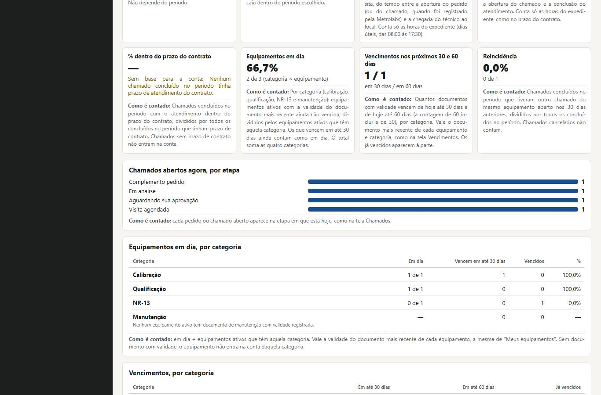

_Indicadores._

## 12. Relatórios de ciclo da lavadora

Para as lavadoras da empresa com registro de ciclo, a tela mostra os relatórios de cada ciclo e permite gerar o relatório a partir do arquivo do ciclo que a lavadora grava.

**Passo a passo**

1. Abra "Relatórios de ciclo" e busque pela TAG, série, lote ou data.
2. Para gerar um relatório, escolha a lavadora, importe o arquivo do ciclo, confira o lote, a data e a receita e confirme.
3. O relatório pode ser assinado na tela pelo responsável do local. Depois de assinado, só a Metrolabs abre uma versão nova, com motivo.

> O botão "Gerar relatório do ciclo" também aparece no prontuário aberto pelo QR Code da lavadora.

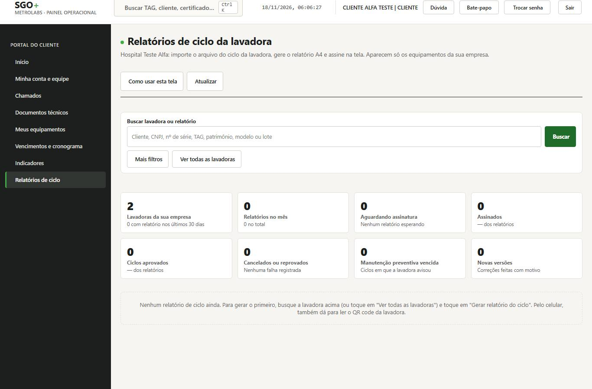

_Relatórios de ciclo da lavadora._

## 13. Minha conta e equipe

Em "Meus dados" você confere o seu papel e as suas unidades, corrige nome, cargo e telefone e escolhe os avisos por e-mail. O e-mail de acesso só a Metrolabs troca.

A aba "Minha equipe" aparece para o Gestor do cliente: lista as pessoas da empresa no Portal, com papel, unidades, situação e última entrada, e o registro das ações da empresa.

**Passo a passo**

1. Para incluir uma pessoa, o Gestor preenche nome completo, e-mail de trabalho (individual, nunca de setor), cargo, papel, unidades e o motivo, e toca em "Pedir acesso". A Metrolabs confere e envia o convite.
2. Para tirar o acesso de quem saiu da empresa, o Gestor toca em "Desligar acesso" na linha da pessoa, escreve o motivo e confirma. O acesso cai na hora.

> O Gestor não desliga o próprio acesso; para isso, fale com a Metrolabs.

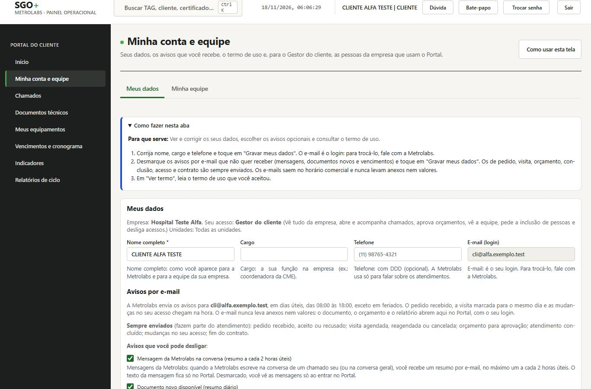

_Meus dados e avisos por e-mail._

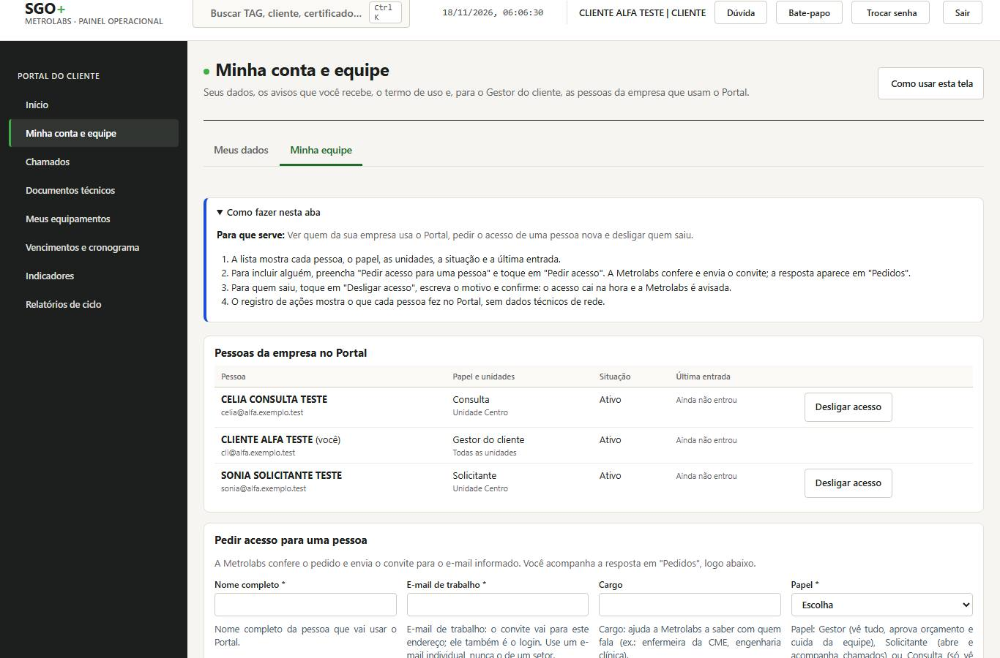

_Minha equipe (Gestor do cliente)._

## 14. Avisos por e-mail (preferências)

A Metrolabs envia os avisos para o seu e-mail de acesso, em dias úteis, das 08:00 às 18:00. O pedido recebido, a visita marcada para o mesmo dia e as mudanças no seu acesso chegam na hora. O e-mail nunca leva anexo nem valores: o documento, o orçamento e o relatório abrem no Portal, com o seu login.

| Aviso | Quais |
|---|---|
| Sempre enviados | Pedido recebido, aceito ou recusado; visita agendada, reagendada ou cancelada; orçamento para aprovação (Gestor do cliente); atendimento concluído; mudanças no seu acesso; fim do contrato. |
| Você pode desligar | Mensagem da Metrolabs na conversa (resumo a cada 2 horas úteis); documento novo disponível (resumo diário); vencimentos dos equipamentos (resumo semanal, para o Gestor do cliente). |

**Passo a passo**

1. Abra Minha conta e equipe > Meus dados.
2. Em "Avisos por e-mail", marque ou desmarque os avisos que podem ser desligados.
3. Toque em "Gravar meus dados".

## 15. Senha, ajuda e saída

No topo da tela ficam "Trocar senha" e "Sair". Em cada tela, "Como usar esta tela" explica os campos e os botões daquela tela, e o Início tem o "Manual do Portal" para ler ou imprimir.

**Passo a passo**

1. Para trocar a senha, toque em "Trocar senha", informe a senha atual e a nova e confirme. As suas outras entradas abertas são encerradas.
2. Ao terminar, toque em "Sair", principalmente em computador compartilhado.

> Por segurança, o sistema encerra a entrada depois de um tempo sem uso.

## 16. Se algo der errado

| O que aconteceu | O que fazer |
|---|---|
| O link do convite venceu ou não chegou. | Confira a caixa de spam. Se não estiver lá, peça um novo convite ao Gestor do cliente da sua empresa ou à Metrolabs. |
| Aparece "Não encontrado. Atualize a lista." | O registro é de uma unidade que não está liberada para o seu acesso, ou foi alterado. Atualize a tela; se continuar, fale com o Gestor do cliente. |
| O botão "Abrir chamado" não aparece. | No papel Consulta, o Portal não abre chamado. Peça ao Gestor do cliente da sua empresa. |
| Um documento que eu procuro não está na lista. | Veja a aba "Por pastas (prontuário)". Se não estiver em nenhuma das duas, avise pela Conversa geral. |
| Aparece uma mensagem dizendo que a tela não faz parte do Portal. | Abra o que precisa pelo menu do Portal. Se algo que você usava parou de funcionar, avise a Metrolabs pela Conversa geral. |
| O acesso da empresa aparece suspenso ou em modo consulta. | Fale com a Metrolabs pelo contato indicado na faixa do topo. |

